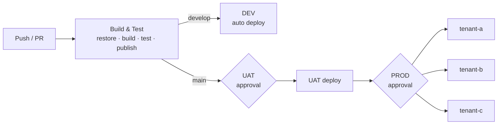
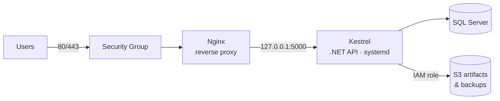

# Infrastructure Architecture

This document explains how the pieces in this repository fit together: how infrastructure is provisioned, how servers are configured, and how a code change reaches production.

## 1. Overview

| Layer | Tool | Where |
|---|---|---|
| Cloud resources | Terraform | [`terraform/main.tf`](../terraform/main.tf) |
| Server configuration | Ansible | [`ansible/site.yml`](../ansible/site.yml) |
| Build & release | GitHub Actions | [`.github/workflows/deploy.yml`](../.github/workflows/deploy.yml) |
| Local / containerised stack | Docker Compose | [`docker-compose.yml`](../docker-compose.yml) |

The lifecycle runs in one direction: **Terraform creates the server → Ansible configures it once → GitHub Actions ships every release to it.** Each tool owns one layer and doesn't reach into the others.

## 2. Environments

| Environment | Branch | Deployment | Approval | Purpose |
|---|---|---|---|---|
| DEV | `develop` | Automatic on push | None | Integration testing by developers |
| UAT | `main` | After build | Required reviewer | Business / QA sign-off |
| PROD | `main` | After UAT succeeds | Required reviewer | Live tenants, deployed as a matrix |

Every environment is a separate **GitHub Environment** with its own secrets (`DEPLOY_HOST`, `DEPLOY_USER`, `DEPLOY_SSH_KEY`, `DEPLOY_KNOWN_HOSTS`). A DEV job can't read PROD credentials.

## 3. CI/CD flow



Key decisions:

- **Build once, deploy many.** The tarball built in the `build` job is the exact artifact deployed to DEV, UAT and every production tenant. Nothing is rebuilt between environments.
- **Matrix production deploy.** Each tenant server is one matrix entry. `max-parallel: 2` limits the blast radius, and `fail-fast: false` means one tenant's failure (already rolled back) doesn't cancel deployments that are in progress elsewhere.
- **Concurrency guard.** Only one deployment per branch runs at a time, and a running deployment is never cancelled half-way.
- **Path filters.** Only changes under `src/` or `tests/` trigger a build. Infrastructure and documentation changes don't redeploy the API.

## 4. Release mechanism (zero-downtime switch + rollback)

Both the pipeline ([`.github/actions/ssh-deploy`](../.github/actions/ssh-deploy/action.yml)) and Ansible (`--tags deploy`) use the same layout on the server:

```
/opt/api/
├── releases/
│   ├── 3f2a9c1.../     ← previous
│   └── 8b7e4d0.../     ← new
└── current -> releases/8b7e4d0...   (systemd runs from here)
```

1. Upload the release into a new `releases/<sha>/` directory. The live app is untouched.
2. Atomically swap the `current` symlink (`ln -sfn` + `mv -T`).
3. `systemctl restart api`
4. Poll `http://127.0.0.1:5000/health` for up to 60 seconds.
5. **Healthy:** prune old releases, keeping the newest 5. **Unhealthy:** point `current` back at the previous release, restart, and fail the job.

Rolling back by hand is the same symlink swap to any of the retained releases.

## 5. Server layout



- **Nginx** is the only public listener. It adds security headers, enforces request size limits and forwards `X-Forwarded-*` headers. The app must enable `UseForwardedHeaders` so it sees the real client IP and scheme.
- **Kestrel** binds to `127.0.0.1` only, so it can't be reached from outside the host.
- **systemd** runs the API as the unprivileged `api` user, with sandboxing (`NoNewPrivileges`, `ProtectSystem`, `PrivateTmp`) and automatic restart.

In the Docker Compose version, the same separation is done with networks: `frontend` (Nginx ↔ API) and an `internal` `backend` network (API ↔ DB) that has no host or internet access.

## 6. Security

| Area | Control |
|---|---|
| Network | Security group allows only 80/443 publicly. SSH is restricted to admin CIDRs (Terraform rejects `0.0.0.0/0`). UFW on the host. |
| Access | SSH keys only, no root login, fail2ban. SSM Session Manager available without opening port 22. |
| Least privilege | The CI `deploy` user can only run `systemctl restart api` through sudo. The EC2 IAM role can reach only its own S3 bucket. |
| Instance | IMDSv2 enforced (`http_tokens = required`), encrypted EBS root volume. |
| Storage | S3 bucket private, versioned, AES-256 encrypted, TLS-only bucket policy. |
| Secrets | Kept out of the repository: GitHub Environment secrets for CI, Ansible Vault for server config, `.env` (git-ignored) for Compose. SSH host keys are pinned with `known_hosts`, so first connection isn't blindly trusted. |
| Patching | Unattended security upgrades enabled by Ansible. |

## 7. Provisioning a new environment

```bash
# 1. Infrastructure
cd terraform
terraform apply -var-file=env/uat.tfvars

# 2. Configuration: add the `ansible_inventory_line` output to inventory.ini
cd ../ansible
ansible-galaxy collection install -r requirements.yml
ansible-playbook site.yml -l uat --ask-vault-pass

# 3. Create the `uat` GitHub Environment with its secrets and reviewers.
#    The next merge to main deploys to it.
```

## 8. Possible next steps

- Put an Application Load Balancer with ACM certificates in front for managed TLS, and run more than one instance per tenant
- Move SQL Server to Amazon RDS for automated backups and Multi-AZ
- Ship logs and metrics to CloudWatch (agent installed through Ansible)
- Switch CI from SSH keys to GitHub OIDC → AWS SSM `send-command`, so the pipeline needs no long-lived credentials
